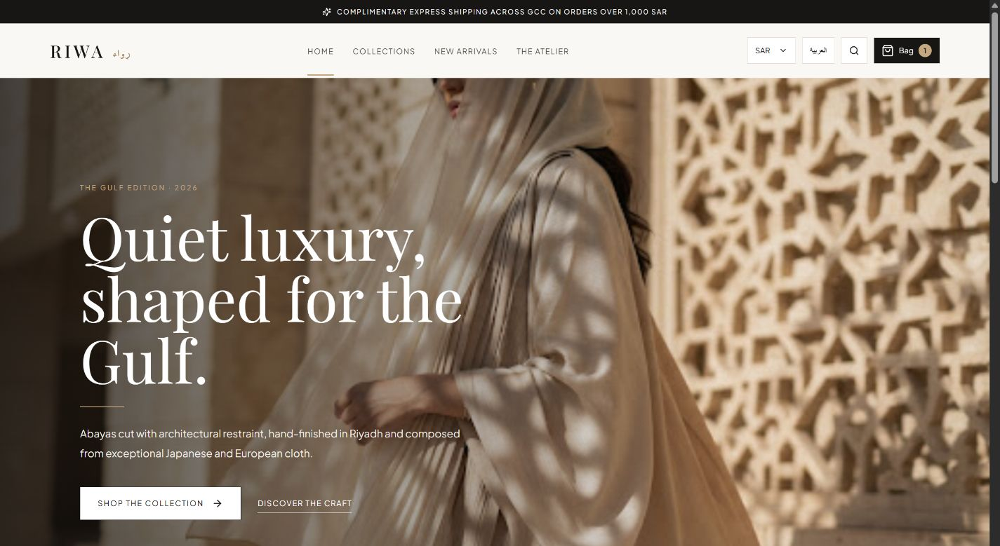

# RIWA Abaya Atelier | دار رِواء للعباءات

A refined abaya storefront focused on product detail and a considered shopping journey. Visitors can explore collections, select sizes, switch display currencies, manage a persistent cart, and complete a clearly simulated checkout.

[Live demo](https://eng-ayatnassar.github.io/riwa-abaya-store/) · [Source code](https://github.com/eng-ayatnassar/riwa-abaya-store) · [Ayat Nassar's portfolio](https://eng-ayatnassar.github.io/)



## Overview

Designed and developed by **Ayat Nassar** as a bilingual front-end portfolio project. The interface supports English and Arabic RTL, responsive layouts, and practical client-side interactions.

## Features

- Collection filtering and sorting
- Product gallery, size selection and size guide
- Currency display and persistent shopping cart
- Demo checkout with cart reset and bilingual service information

## Tech stack

React · JavaScript · Tailwind CSS · Vite

## Run locally

Requires **Node.js 22.12 or newer**.

```bash
npm ci
npm run dev
```

On Windows, you can also run `start.cmd`.

## Production build

```bash
npm run build
npm run preview
```

The build is written to `dist/`. Relative asset paths support deployment under a GitHub Pages repository path.

## Demo scope

**Frontend Demo.** No real orders, payments, shipping, returns, or newsletter subscriptions are processed. Preferences and cart data stay in the browser. Use fictional input when trying forms. External imagery and fonts depend on their providers.

## Deployment

The GitHub Actions workflow installs locked dependencies, checks known high-severity advisories, builds, and deploys to GitHub Pages on pushes to `main`. Pull requests run the build without deployment. Repository Pages settings use **GitHub Actions** as the source.

Source, lockfiles, and preview images are tracked. `node_modules/`, `dist/`, secrets, and local logs are excluded.

## بالعربية

واجهة متجر عباءات تمنح تفاصيل المنتج مساحة بارزة، وتغطي استعراض المجموعة واختيار المقاس وتبديل العملة وإدارة سلة محفوظة محلياً، وصولاً إلى إتمام طلب تجريبي بواجهة عربية وإنجليزية.

- تصفية المجموعة وترتيب المنتجات
- معرض صور واختيار المقاس ودليل للمقاسات
- عرض العملات وسلة محفوظة محلياً
- طلب تجريبي ومعلومات خدمة باللغتين

هذا المشروع عرض Frontend لمعرض الأعمال، وليس خدمة تجارية متصلة بخادم أو نظام دفع أو حسابات حقيقية.
